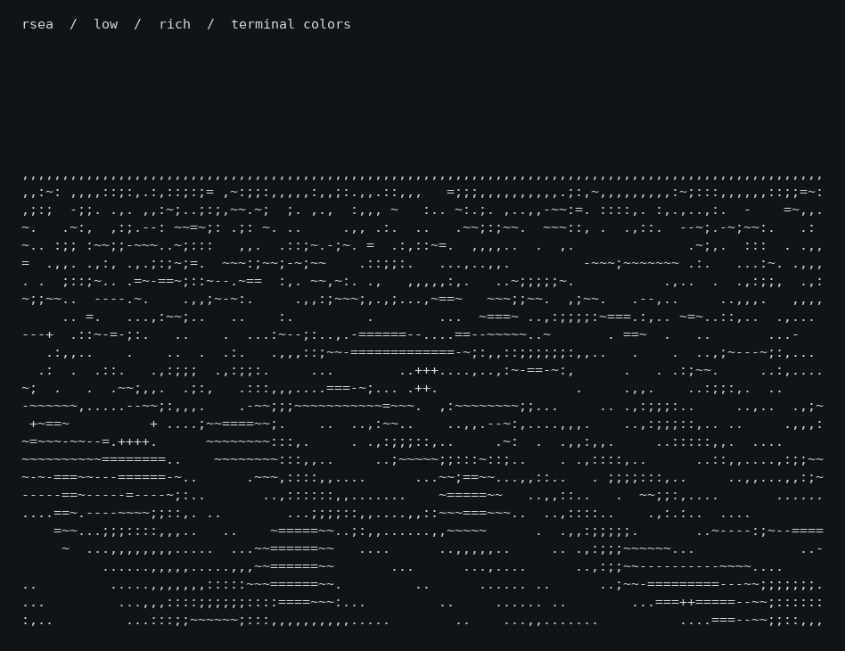

# rsea

A quiet 3D sea, drawn entirely with ASCII characters. Watch overlapping swells,
fine ripples, and broken foam from close to the water. Inspired by
[cbonsai](https://gitlab.com/jallbrit/cbonsai).



## Run

Requires Rust 1.85 or newer and an interactive terminal with ANSI support
(for example, Windows Terminal on Windows).

```sh
cargo run --release
```

Or install from this checkout:

```sh
cargo install --path . --locked
rsea
```

The default is **Open water**, **Close to the water**, **Rich** detail, using your
terminal's foreground and background. The sea, status line, and help leave your
background untouched, including terminal transparency. The scene contains only
water and an empty horizon.

```sh
rsea --viewpoint low --detail rich
rsea --seed 42
rsea --viewpoint raised --detail balanced
rsea --sea swell --speed 0.5
rsea --theme night
rsea --theme ocean --color truecolor
```

## The water

The camera traces a moving 3D surface: nearby crests hide more distant waves,
ripples grow toward the viewer, and shading follows the slopes. Fine texture and
foam move with the water. Motion follows elapsed time, with a 30 FPS rendering
limit; pause freezes the scene without accumulating time.

The same seed, dimensions, settings, and simulated time reproduce the same
frame. Seed **42** uses the waves from the approved browser design. Other seeds
vary the crossing swells. The default seed is generated at startup and shown in
help.

Automatic resizing and changed-cell rendering keep the display responsive. The
screen, cursor, line wrapping, and input mode are restored on normal exit,
errors, or unwinding panics. Ctrl-C and termination signals also exit cleanly.

## Controls

| Key | Action |
| --- | --- |
| `Space` / `p` | Pause or resume |
| `v` | Switch between low and raised viewpoints |
| `d` | Cycle balanced, detailed, and rich surface detail |
| `t` | Cycle terminal, ocean, day, sunset, and night palettes |
| `c` | Cycle calm, swell, and storm conditions |
| `+` / `↑` | Increase speed |
| `-` / `↓` | Decrease speed |
| `?` / `h` | Show or hide help, including the current seed |
| `q` / `Esc` / `Ctrl-C` | Quit |

Viewpoint, detail, and palette changes work while paused and preserve the
animation clock. Optional palettes color only the foreground; every theme uses
your terminal's background. Palettes never add a sun, moon, or birds.

## Options

| Option | Default | Values |
| --- | --- | --- |
| `--viewpoint` | `low` | `low` (close to the water), `raised` |
| `--detail` | `rich` | `balanced`, `detailed`, `rich` |
| `--theme` | `terminal` | `terminal`, `ocean`, `day`, `sunset`, `night` |
| `--sea` | `calm` | `calm`, `swell`, `storm` |
| `--speed` | `1` | `0.1`–`5` |
| `--intensity` | `1` | `0`–`3`; zero produces still, flat water |
| `--seed` | Generated on startup | An unsigned 64-bit integer |
| `--color` | `auto` | `auto`, `ansi` (256 colors), `truecolor`, `none` |
| `--ascii` | Always enabled | Accepted for compatibility; all scene glyphs are ASCII |

The `terminal` theme uses your terminal's default foreground, even with
`--color truecolor`. Wave shading comes from the ASCII characters themselves.

For optional palettes, automatic color uses true color when `COLORTERM=truecolor` / `24bit` or
`TERM=*-direct` advertises it, otherwise 256 colors. A nonempty `NO_COLOR`,
`TERM=dumb`, or redirected stdout disables automatic color. An explicit color
mode overrides detection. For the ocean shading palette, use
`--theme ocean --color truecolor` in a compatible terminal.

## Still frames

Snapshots work without a TTY and contain no cursor or alternate-screen commands.
They are plain text with the terminal theme, or when piped unless palette colors
are explicitly requested.

```sh
rsea --snapshot --seed 42 > sea.txt
rsea --snapshot --seed 42 --time 5 --width 100 --height 32
rsea --snapshot --theme ocean --color truecolor
rsea --snapshot --viewpoint raised --theme night
```

Snapshot dimensions default to **100 × 32**, with limits of 1–500 columns and
1–200 rows. `--time` is simulated seconds (0–86400), independent of `--speed`.
These three options apply only to `--snapshot`.

## Development

Built with [crossterm](https://docs.rs/crossterm/0.29.0/crossterm/) for terminal
handling and [clap](https://docs.rs/clap/latest/clap/) for argument parsing.
`src/ocean.rs` handles the surface, camera, intersections, and shading;
`src/scene.rs` applies palettes and builds frames. Input and terminal I/O are
separate from the renderer.

```sh
cargo fmt --check
cargo clippy --all-targets -- -D warnings
cargo test --locked
cargo build --locked
python3 tests/terminal_smoke.py  # Unix: exercises the real binary in a PTY
```

Tests cover the approved browser reference frame, 3D intersections and lighting,
flat water, extreme settings, CLI validation, and controls. The PTY check covers
terminal colors, background preservation, ASCII defaults, pause/resume,
viewpoints, detail, tiny terminals, resizing, and
terminal restoration after normal exit, Ctrl-C, SIGINT, SIGTERM, and SIGHUP.

Licensed under [Apache-2.0](LICENSE).
